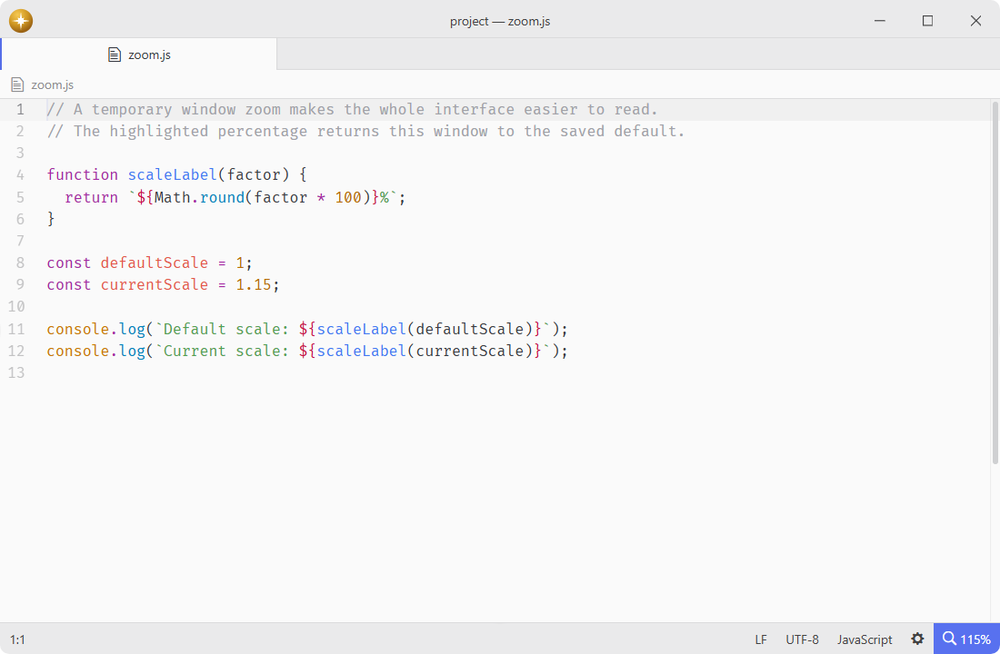
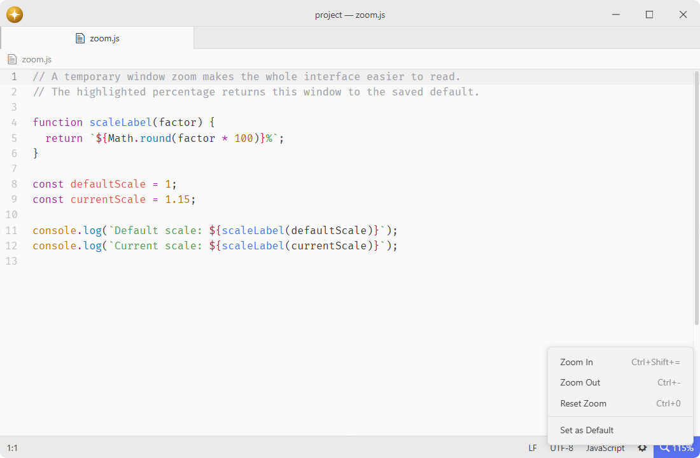

# window-zoom

Show the current window zoom when it differs from the default.

## Features

- **Zoom indicator**: displays the current window scale as a percentage in the status bar.
- **Conditional visibility**: hides at the configured default zoom unless you choose to keep it visible.
- **Highlighted tile**: uses the current theme's accent colors to make a temporary zoom easy to notice.
- **Quick reset**: click the indicator to restore the configured default for the current window.
- **Window controls**: right-click the indicator to zoom in, zoom out, or reset the current window.
- **Saved default**: choose Set as Default in the context menu to store the current scale as the shared default for all windows.





## Installation

To install `window-zoom` search for it in the Install pane of the Lumine settings, or run the command `lumine --install lumine-code/window-zoom`.

## Commands

Commands available in `lumine-workspace`:

- `window-zoom:set-as-default`: save the current window scale as the global default.

## Customization

Add this to your `styles.css` to adjust the indicator's appearance:

```css
.window-zoom {
  font-weight: 600;
  border-radius: 4px;
}
```

## Services

- `background-tips.provider`: provided to share a tip about the window zoom indicator.
- `status-bar`: consumed to display the current window zoom.

## Contributing

Got ideas to make this package better, found a bug, or want to help add new features? Just drop your thoughts on GitHub. Any feedback is welcome!
